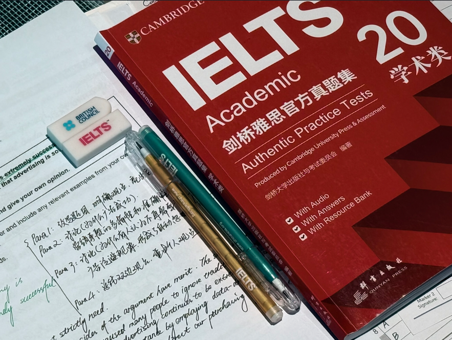
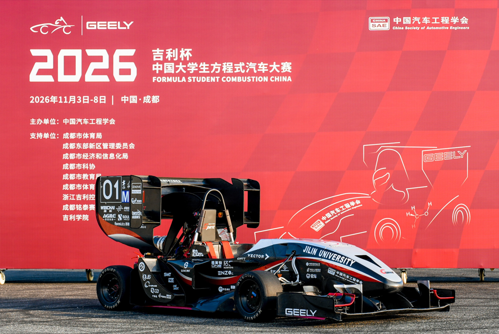

## 0. 我的最后一个悠闲的暑假

在开学之前也是拿到雅思考试的大结果了（区区7.0）
必须恶狠狠的告诉全世界嘿嘿嘿

## 1. 开学的第一个月

解决了大创结题的一些内容，处理了许多鸡毛蒜皮的事，见到了很多新同学们。
（感觉学弟学妹们都好有活力啊，我身边人都死气沉沉的TAT）

方程式比赛前几周，在车队帮忙做了一些收尾的内容。又去了一趟成都。

在东大这方面，和学长学姐们顶出来了第一篇SCI（虽然我不是一作，但我很知足啦），又和冶金学院的同学们去了矿厂实景考察，又去了东软（工作氛围过于狼性）

在一院闲着没事弄出来了一个肺炎二分类识别的模型，又被老师物色到了，一直在优化ing~
（ps：还要去拍露骨的照片💀）

## 2. 考研应该如何安排

试着用某AI助手结合我的具体规划写了一个精确到每周的学习计划，感兴趣的家人们可以[点击这里](https://lmy18280.github.io/study.html)去看看喔~

有时觉得自己也挺闲的。好好的车辆不学，偏要去学什么计算机。撞了南墙还不知道回头。

但没有退路了。自己选的路跪着也要走完。

## 3. 迎着光才刻下勋章（王菲《主角》的歌词）

这两个月是开学季，在忙起来之前认识了好多新朋友。
这两个月，吃了好多饭，做了好多事，拿了好多大结果。

从下个月开始，感觉自己必须要冷静下来仔细想一想了，可能和周围朋友的来往也会越来越少了。希望下次和朋友们见面的时候，大家都能侃侃而谈，有新的世界等待着探索，有新的剧本等待着下笔。

## 4. 写在最后

感觉自己考408是这辈子做过的最艰难的决定之一了。

希望408天后的自己，再回来看这条Blog的时候，能会想起自己当时的选择，会想起那个敢于“撞南墙”的自己。
（跳槽408是危险操作，小朋友们千万不要模仿哦）

## ---END---